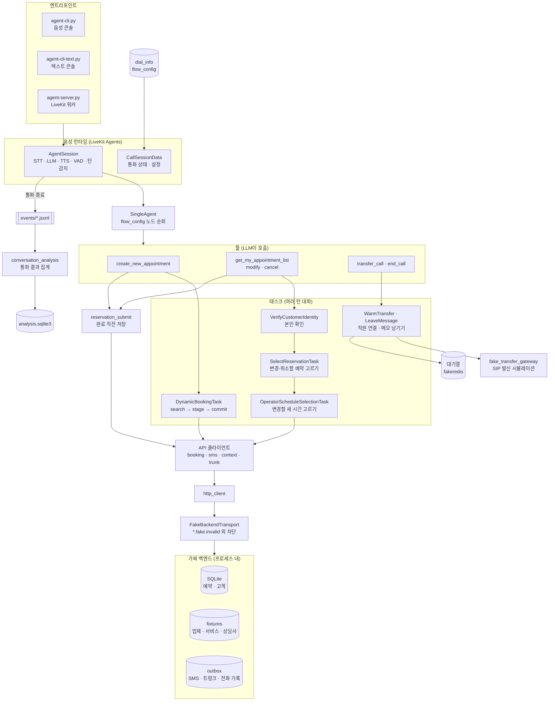
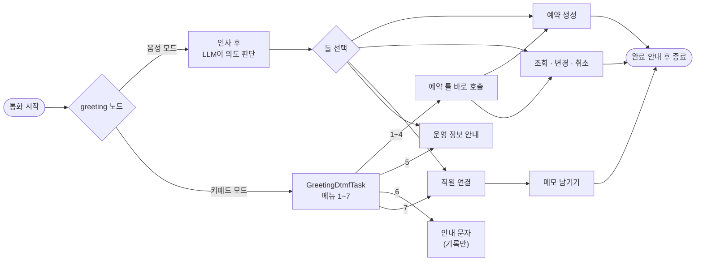
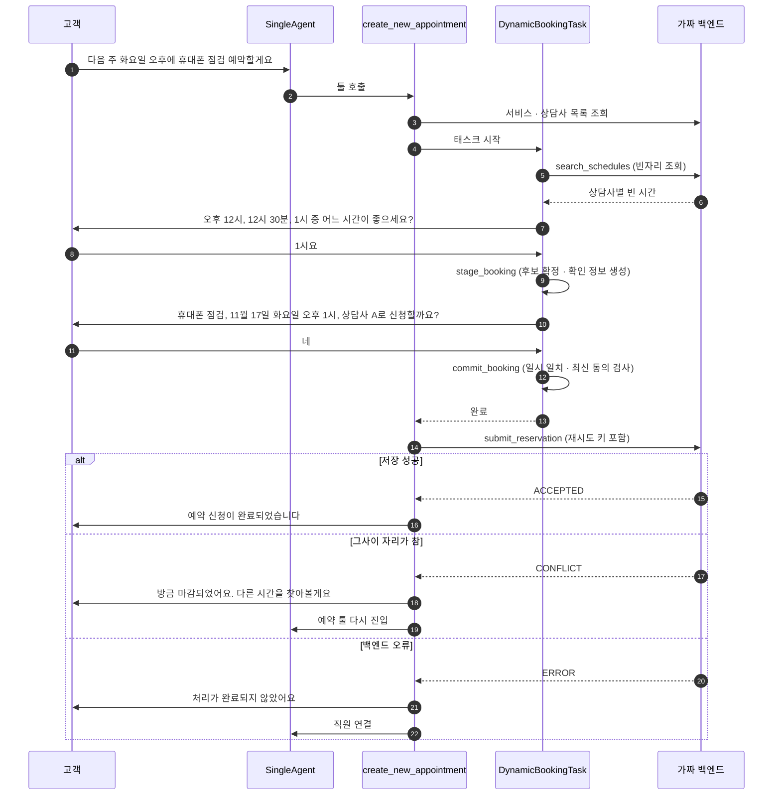

# Service Center Voice Agent

가상의 전자기기 서비스센터 **Example Device Care**를 위한 한국어 음성 상담
에이전트입니다. 고객은 전화로 서비스와 운영 시간을 묻고, 빈 시간을 찾고,
점검 예약을 신청·조회·변경·취소할 수 있습니다. 직원 연결도 요청할 수 있지만
실제 연결은 시뮬레이션입니다.

## 시스템 설계

### 전체 구성

통화 한 건은 위에서 아래로 흐릅니다. 업무 시스템과 닿는 모든 HTTP 호출은
하나의 클라이언트 생성 함수를 거치고, 그 아래의 가짜 백엔드 transport가
`*.fake.invalid` 호스트만 처리하고 나머지는 차단합니다.



### 통화 흐름

`flow_config`의 노드 그래프가 통화 순서를 정합니다. 키패드 메뉴에서 번호를
누르면 LLM을 거치지 않고 해당 툴이 바로 호출됩니다.



### 예약 생성 시퀀스

예약 태스크는 조회한 빈자리만 후보로 올릴 수 있고, 확정은 고객의 새 동의가
있을 때만 됩니다. 성공 안내는 저장이 끝난 뒤에만 나갑니다.



### 지켜야 할 조건과 강제하는 위치

| 조건 | 강제하는 곳 |
| --- | --- |
| 빈자리는 백엔드에서 온 것만 제안 | `search_schedules` · `stage_booking`, 저장 시 백엔드가 일정 재검증 |
| 제안에는 서비스·날짜·요일·시간·상담사 포함 | `stage_booking`의 확인 정보, 코드가 만드는 날짜 표현 |
| 동의는 제안 직후의 새 발화여야 함 | `commit_booking`: 일시 일치 + 제안 후 고객 턴이 정확히 1개 |
| 이중 예약 금지 | `(상담사, 시작 시각)` 부분 유니크 인덱스 + `BEGIN IMMEDIATE` |
| 재시도해도 중복 저장 없음 | 재시도 키 = 통화 + `reservation_info` 해시 |
| 본인 예약만 변경·취소 | 발신 번호 소유 확인, 없는 예약과 남의 예약은 같은 응답 |
| 성공 안내는 저장 후에만 | 저장 성공 시에만 완료 문구, 실패 시 예약 정보 비움 |
| 업무 트래픽은 외부로 나가지 않음 | transport가 가짜 호스트 외 차단, 테스트는 소켓 차단 |

## 보여 주는 것

- **근거 있는 예약:** 조회한 빈자리만 제안할 수 있습니다. 날짜와 요일은
  코드가 만들고, 제안할 때는 서비스·날짜·시간·상담사를 모두 말한 뒤 확인을
  받습니다.
- **코드로 강제하는 동의:** 확정하는 일시는 제안한 후보와 같아야 합니다. 동의는
  제안 바로 다음의 고객 발화 하나여야 합니다.
- **안전한 저장:** 완료를 안내하기 전에 예약을 먼저 저장합니다. 데이터베이스
  제약으로 이중 예약을 막고, 같은 요청을 다시 보내면 새로 저장하지 않고 이전
  결과를 돌려줍니다. 고객은 본인 예약만 변경·취소할 수 있습니다.
- **복구 가능한 실패:** 그사이 다른 사람이 자리를 가져가면 다시 시간을 찾습니다.
  백엔드 오류를 성공으로 안내하지 않고, 직원에게 연결합니다.
- **실제 음성 런타임:** LiveKit Agents 1.8.6 기반입니다. STT, LLM, TTS, VAD,
  턴 감지를 쓰고, DTMF 키패드 메뉴와 상담원 연결 대기열을 지원합니다. 전화
  연결 자체는 시뮬레이션입니다.
- **검증 근거:** 오프라인 테스트가 약 1800개입니다(S01–S21 시나리오 포함).
  LLM이 고객을 연기하는 라이브 테스트 세트와 통화 후 로컬 분석 단계도 있습니다.

## 요구 사항

- Python 3.13과 [uv](https://docs.astral.sh/uv/)가 필요합니다.
- 설치 후 오프라인 테스트는 **인증정보와 네트워크 없이** 실행됩니다.
- 라이브 텍스트 모드에는 `OPENAI_API_KEY`가 필요합니다. 키가 없으면 명확한 설정
  오류로 멈추며, 다른 계정이나 엔드포인트로 대신 넘어가지 않습니다.
- 라이브 음성 모드에는 다음도 필요합니다.
  - `ELEVEN_API_KEY` (STT)
  - `CARTESIA_API_KEY` (TTS)
  - LiveKit 프로젝트 (`LIVEKIT_URL`, `LIVEKIT_API_KEY`, `LIVEKIT_API_SECRET`)
  - 마이크와 스피커

```bash
uv sync --locked
cp .env.example .env   # 필요한 키만 채워 넣으세요
```

## 실행

| 목적 | 명령 |
| --- | --- |
| 오프라인 테스트 (인증정보 불필요) | `uv run pytest tests` |
| S01–S21 시나리오만 | `uv run pytest tests/scenarios` |
| 데모 데이터 초기화 / 조회 | `uv run python tools/demo.py reset` · `uv run python tools/demo.py show` |
| 라이브 텍스트 (직접 입력) | `uv run python src/agent-cli-text.py console --text` |
| 라이브 텍스트 (고객 시뮬레이터) | `uv run python tools/customer-sim.py` (페르소나를 묻습니다) |
| 라이브 회귀 테스트 세트 | `uv run python tools/sim-suite.py` (시나리오 5개, LLM 채점) |
| 라이브 음성 (마이크) | `uv run python src/agent-cli.py console` |
| 통화 후 분석 | `uv run python conversation_analysis/main.py --show` |
| 린트 | `uv run ruff check src tools tests conversation_analysis` (보고 39건. 대부분 API 필드의 `mixedCase` 이름입니다) |

5분짜리 시연 순서는 `docs/demo-script.md`에 있습니다.

## 데모 데이터

| 항목 | 값 |
| --- | --- |
| 운영 시간 | 평일 09:00–18:00 (마지막 예약 17:30), 30분 단위, 14일 이내 예약, Asia/Seoul |
| 서비스 | 휴대폰 점검, 노트북 상담, 소형기기 점검 |
| 상담사 | 상담사 A (휴대폰·노트북, 평일 전 시간), 상담사 B (휴대폰·소형기기, 화·목 종일, 월·수·금 오후) |
| 기본 발신자 | DC-1001 (`01000000001`). 예약 1건이 있는 기존 고객 |
| 키패드 설정 | `DIAL_INFO_FILE=src/dial_info/dial_info.keypad.ko.yaml`. 발신자 DC-1002, 데모 확인번호 `000202` |

모두 가상의 데이터입니다. 전화번호에는 할당되지 않은 `010-0000-xxxx` 대역을
썼습니다.

## 폴더 구조

```text
src/                    에이전트 런타임 (엔트리포인트, 에이전트, 태스크, 툴, 프롬프트, 유틸)
src/fake_backend/       프로세스 내 가짜 서비스 + SQLite 저장소 + 장애 주입
src/dial_info/          가상 통화 설정
fixtures/               가상 업체·서비스 목록·고객·안내 자료
conversation_analysis/  통화 후 로컬 분석기
tools/                  고객 시뮬레이터, 회귀 테스트 세트, 데모 도구
simulations/            가상 시뮬레이션 시나리오
tests/                  characterization/ (단위·특성 테스트), integration/, unit/, scenarios/ (S01–S21)
docs/                   아키텍처, 평가, 시연 순서
```

## 패키지 검증

- 내보낸 폴더에서 새로 설치해 검증했습니다.
  - 내보내기 명령은 `uv run python tools/release_export.py <폴더>`입니다.
    Git이 추적하는 파일만 복사하고, 내부 문서는 제외하며, 민감정보 검사를
    거칩니다.
  - `.env` 없이 `uv sync --locked`로 설치하고 `uv run pytest tests`를 실행해
    1796개가 통과했습니다. 그 밖에 알려진 실패 1건이 예상된 실패(xfail)로
    표시됩니다.
- 라이브 검증은 작업용 저장소에서 실행했습니다(`docs/evaluation.md`).

## 장애 주입

장애는 `DEMO_FAULTS`(JSON)로만 지정합니다.

- 예: `DEMO_FAULTS='{"trunk": ["busy","available"], "reservation_submit": "error"}'`
- 시계 고정: `DEMO_NOW=2026-11-16T09:30:00+09:00`
- 지원하는 항목은 `src/fake_backend/faults.py`를 참고하세요.

## 한계

- **실제로 연결된 시스템은 없습니다.** 실제 예약, 문자, 전화, 직원 연결은
  일어나지 않습니다. 상담원 연결이 성공하는 경우도 시뮬레이션하지 않아서,
  직원 연결은 항상 대체 경로(재시도 후 메모 남기기)로 진행됩니다.
- **본인 확인은 발신 번호와 데모 확인번호(숫자 6자리)뿐입니다.** 실제 신원
  확인이나 다른 기기에서의 조회는 지원하지 않습니다.
- **최신 동의 검사는 구조적 검사입니다.** 제안 바로 다음 고객 발화가 정말
  "네"인지는 코드가 판단할 수 없고, 그 판단은 여전히 모델의 몫입니다.
- **오프라인 테스트는 모델의 턴을 스크립트로 대신합니다.** 그래서 검증하는
  것은 애플리케이션 계약이지 언어 이해가 아닙니다. 라이브 결과는 표본이
  작습니다(`docs/evaluation.md`).
- **마이크 통화는 아직 확인하지 않았습니다.** STT·TTS 키와 한국어 품질은
  합성한 음성을 다시 인식시키는 방식으로만 확인했습니다.

## 문서

- `docs/architecture.md`: 구성 요소, 통화 흐름, 지켜야 할 조건과 이를 강제하는 위치
- `docs/evaluation.md`: 오프라인 시나리오 표(S01–S21)와 라이브 결과
- `docs/demo-script.md`: 5분 시연 순서
