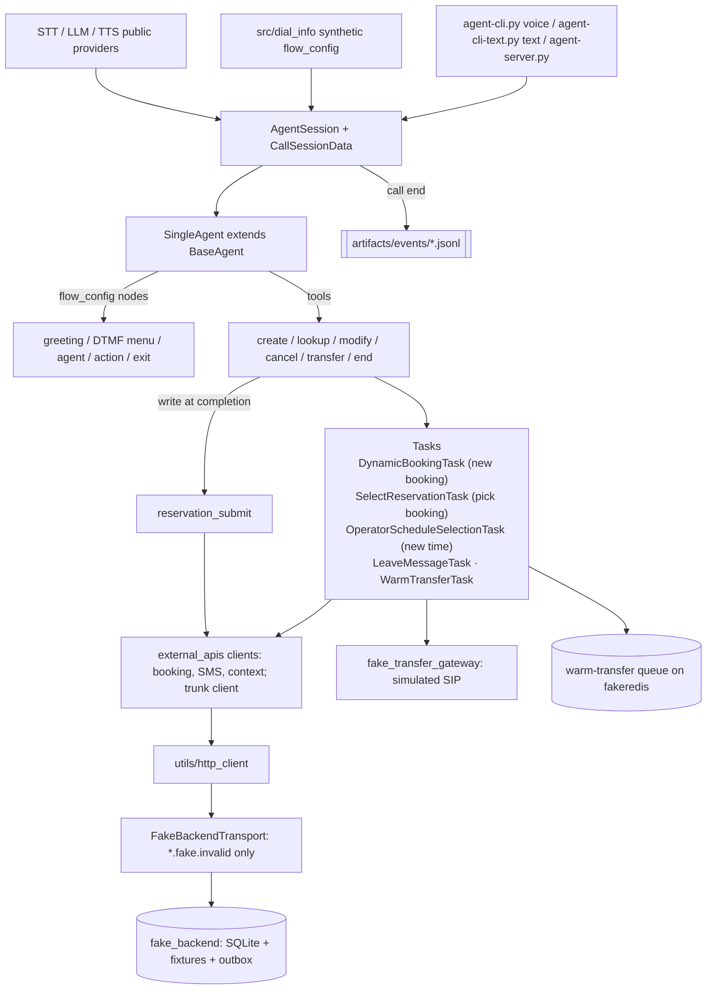

# Architecture



## Call flow

1. The entrypoint loads synthetic `dial_info`, builds `CallSessionData`, and
   starts `SingleAgent`. In voice mode the session gets STT/TTS/VAD; in text
   mode it uses manual turns.
2. `SingleAgent.on_enter` walks `flow_config`:
   - a `greeting` node speaks the greeting, or runs `GreetingDtmfTask` for a
     keypad menu;
   - an `agent` node forces a tool call (for example, menu key 1 calls
     `create_new_appointment` without asking the LLM);
   - `action` and `exit` nodes handle transfer, leave-message, and hang-up.
3. The LLM chooses tools from the caller's words. Booking tools run tasks that
   own the multi-turn dialogue.

## Booking (create)

```text
create_new_appointment
  ├─ resolve identity (known customer, or phone lookup + 6-digit demo code)
  ├─ load_booking_reference  → GET services/operators (fake backend)
  ├─ DynamicBookingTask
  │    search_schedules   → GET schedules (DATE / DATE_TIME), code-rendered dates
  │    stage_booking      → availability check, returns confirmation facts
  │    (caller consents in the next turn)
  │    commit_booking     → staged == confirmed, fresh-consent check → reservation_info
  ├─ merge identity fields
  ├─ submit_current_reservation (reservation write) → POST /reservation/{site}/requests
  │    ACCEPTED → success line and hang-up
  │    CONFLICT → "just taken", re-enter create_new_appointment
  │    NOT_FOUND / ERROR → say not completed; booking-exit router
  └─ call end → event log
```

Modify and cancel follow this path: lookup, then `SelectReservationTask`,
then (for modify) `OperatorScheduleSelectionTask`, then the reservation write, then announce.

## Invariants and where they are enforced

| Invariant | Enforced by |
| --- | --- |
| Slots come only from the backend | `search_schedules` / `stage_booking` grounding; the backend re-validates the calendar on submit |
| The proposal includes service, date with weekday, time, and advisor | `stage_booking` confirmation payload; code-rendered spoken dates |
| Consent is fresh and bound to the proposal | `commit_booking`: staged == confirmed, and exactly one new user turn after staging |
| Changing the slot invalidates consent | Re-staging resets the anchor; `staging_mismatch` |
| No double booking | Partial unique index `(operator_id, start_at) WHERE CONFIRMED` + `BEGIN IMMEDIATE` |
| Retries do not duplicate | Idempotency key = room + hash(reservation_info) |
| Ownership | Modify/cancel require that the appointment belongs to the caller's phone; unknown and foreign look identical |
| Success language depends on the write | The success line runs only after ACCEPTED; `reservation_info` is cleared on failure |
| No business traffic leaves the process | The transport blocks non-fake hosts; tests block sockets |

## Data

- `fixtures/business.json`: hours (weekdays 09:00–17:30 starts, 30-minute slots)
  and a 14-day horizon.
- `fixtures/catalog.json`: 3 services (services 301–303) and 2 advisors
  (operators 401–402) with skills and hours.
- `fixtures/customers.json`: 2 synthetic customers on the unassigned
  `010-0000-xxxx` block, with relative-date appointments.
- `artifacts/` (gitignored): `demo.sqlite3`, `outbox/*.jsonl` (simulated SMS,
  trunk, and telephony), `events/*.jsonl`.
